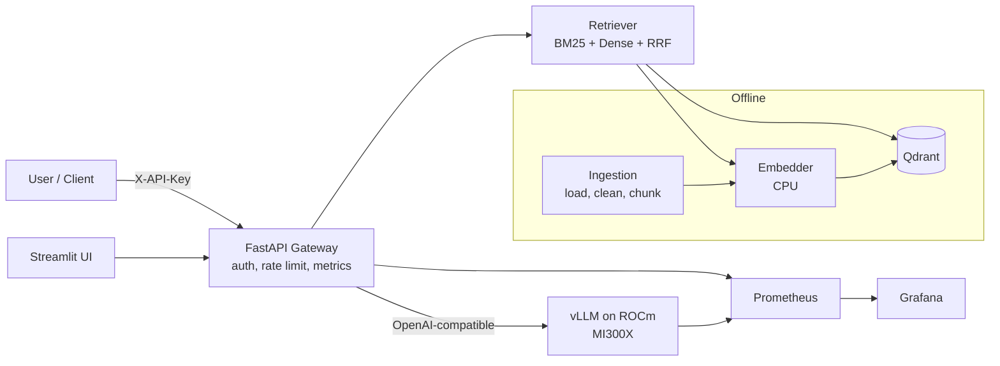

# PROJECT SPEC: PrivateDocs-LLM
### A self-hosted, production-style LLM + RAG platform for confidential company documents, benchmarked on AMD MI300X

> **Instructions for the AI agent (Antigravity):** Read this whole file, then scaffold the repository exactly as described in Section 5. Create all files, stubs, configs, scripts, and docs. Work through the tasks in Section 13 in order. Do not invent paid services. Everything must be free and open source. Anything marked **VERIFY** must be checked against current official docs before being hardcoded (model names, Docker image tags, library versions change quickly). If you cannot verify, put it in `.env.example` as a variable instead of hardcoding it.

---

## 1. Problem statement

Banks, hospitals, law firms, and manufacturers want AI question-answering over internal documents, but compliance and privacy rules often forbid sending that data to third-party APIs. Per-token API costs at scale are also a concern. The standard answer is to self-host an open-weight LLM.

**This project builds and measures that solution**: a private document Q&A platform with auth, monitoring, and an evaluation suite, and answers a research question with real data.

## 2. Research question

> On a single AMD MI300X (192 GB), how do **model size** and **precision (FP16/BF16 vs FP8)** affect **answer quality, latency, throughput, and cost per 1M tokens** for document Q&A, and at what usage level does self-hosting become cheaper than a paid API?

Secondary questions (only if time allows): effect of chunk size, hybrid search vs vector-only, and re-ranking on retrieval recall.

## 3. Hard constraints (non-negotiable)

| Constraint | Detail |
|---|---|
| **Cost** | Total spend = $0. Only AMD Developer Cloud credits ($150, expires **Oct 24, 2026**, no payment method on file). Only free/open-source software. Free tiers (GitHub, Hugging Face) for storage. |
| **GPU budget** | MI300X x1 at **$1.99/hr**. Credit cap about 75 hrs. **Plan to use at most 35 hrs.** Keep 30+ hrs of reserve. |
| **Time** | 7 days. GPU sessions are short and scripted. |
| **Data safety** | Use only **public** documents. No real confidential data. |
| **Droplet is disposable** | With no payment method, the droplet is destroyed at credit exhaustion or expiry. Every GPU session must sync results off the droplet. |
| **Portability** | The same code must run locally on CPU (small model) and on the droplet (large model) by changing only environment variables. |

## 4. Key design decision: develop free locally, burn GPU only for what needs it

The LLM is always accessed through an **OpenAI-compatible HTTP API**, controlled by `LLM_BASE_URL`, `LLM_MODEL`, and `LLM_API_KEY`.

| Environment | LLM server | Model | Cost |
|---|---|---|---|
| **Local dev (laptop, CPU)** | Ollama or llama.cpp server (OpenAI-compatible) | Small model, 1-4B params, quantized | Free |
| **AMD droplet** | vLLM ROCm Docker container | 8B / ~30B / ~70B class, FP16 and FP8 | Credits |

Everything else (RAG, API, UI, monitoring, eval) is identical in both environments. **Embeddings run on CPU** (small embedding model) in both environments. This avoids ROCm library issues and keeps all GPU memory for the LLM.

## 5. Repository structure (create exactly this)

```
privatedocs-llm/
├── README.md                     # Overview, architecture diagram, quickstart, results summary
├── PROJECT_SPEC.md               # This file (copy)
├── LICENSE                       # Apache-2.0
├── Makefile                      # Common commands (see Section 11)
├── .env.example                  # All config variables, no secrets
├── .gitignore
├── pyproject.toml                # Python 3.11+, dependency groups: app, eval, dev
├── docker/
│   ├── compose.local.yml         # Local CPU stack: Ollama, Qdrant, API, UI, Prometheus, Grafana
│   ├── compose.gpu.yml           # Droplet stack: vLLM-ROCm, Qdrant, API, UI, Prometheus, Grafana
│   ├── api.Dockerfile
│   ├── ui.Dockerfile
│   └── prometheus/prometheus.yml
│   └── grafana/
│       ├── provisioning/         # Datasource and dashboard auto-provisioning
│       └── dashboards/llm-platform.json
├── src/privatedocs/
│   ├── __init__.py
│   ├── config.py                 # pydantic-settings, reads .env
│   ├── ingestion/
│   │   ├── loaders.py            # PDF/HTML/TXT/MD loaders
│   │   ├── cleaning.py
│   │   ├── chunking.py           # Pluggable strategies: fixed, recursive, sentence-window
│   │   └── indexer.py            # Embed + upsert to Qdrant
│   ├── retrieval/
│   │   ├── embedder.py           # CPU sentence-transformers wrapper
│   │   ├── vector_store.py       # Qdrant client wrapper
│   │   ├── bm25.py               # Keyword index (rank-bm25)
│   │   ├── hybrid.py             # Reciprocal rank fusion
│   │   └── reranker.py           # Optional cross-encoder (feature-flagged)
│   ├── generation/
│   │   ├── llm_client.py         # OpenAI-compatible client, streaming, retries, timeouts
│   │   └── prompts.py            # Prompt templates with citation format
│   ├── api/
│   │   ├── main.py               # FastAPI app
│   │   ├── auth.py               # API-key auth (hashed keys in a local file/SQLite)
│   │   ├── rate_limit.py         # Simple per-key rate limiting
│   │   ├── schemas.py
│   │   └── metrics.py            # Prometheus metrics (see Section 8)
│   └── ui/app.py                 # Streamlit chat UI with source citations panel
├── eval/
│   ├── README.md
│   ├── datasets/                 # Corpus manifest + eval questions (JSONL), no large files committed
│   ├── build_corpus.py           # Downloads public docs listed in corpus_manifest.yaml
│   ├── generate_questions.py     # LLM-assisted question drafting (human review required)
│   ├── run_retrieval_eval.py     # recall@k, MRR
│   ├── run_answer_eval.py        # Correctness, faithfulness, abstention rate
│   ├── judge.py                  # LLM-as-judge with fixed rubric
│   └── report.py                 # Aggregates results/ into tables and charts
├── benchmarks/
│   ├── README.md
│   ├── matrix.yaml               # Experiment definitions (Section 9)
│   ├── load_test.py              # Async load generator (httpx + asyncio), outputs JSON
│   ├── locustfile.py             # Optional Locust alternative
│   └── cost_model.py             # $/1M tokens and break-even vs API pricing
├── scripts/
│   ├── gpu/
│   │   ├── 00_bootstrap.sh       # Run on droplet: checks, docker, clone repo, env
│   │   ├── 01_check_gpu.sh       # rocm-smi, docker device check, disk check
│   │   ├── 02_start_vllm.sh      # Starts vLLM with MODEL / DTYPE args
│   │   ├── 03_run_experiment.sh  # Runs one matrix entry, saves results
│   │   ├── 04_sync_results.sh    # git add/commit/push results, or HF upload
│   │   └── 99_teardown_checklist.md
│   ├── local/
│   │   ├── setup_dev.sh
│   │   └── smoke_test.sh
│   └── gpu_budget.py             # Tracks session start/stop, prints $ spent
├── results/                      # Raw JSON/CSV from experiments (committed, small)
│   └── .gitkeep
├── docs/
│   ├── architecture.md
│   ├── rocm-notes.md             # Running log: what broke on ROCm and the fix
│   ├── runbook.md                # Ops: start, stop, restore, troubleshoot
│   ├── security.md               # Threat model, what is and isn't protected
│   ├── cost-analysis.md
│   └── gpu-session-log.md        # Every GPU session: start, end, purpose, $ used
├── tests/
│   ├── test_chunking.py
│   ├── test_hybrid.py
│   ├── test_auth.py
│   ├── test_api.py               # Uses a mock LLM server
│   └── mock_llm_server.py
└── .github/workflows/ci.yml      # Lint (ruff), type check (mypy, lenient), pytest. Free tier.
```

## 6. Technology stack (all free / open source)

| Layer | Choice | Notes |
|---|---|---|
| Language | Python 3.11+ | |
| LLM serving (GPU) | **vLLM, ROCm build, official Docker image** | **VERIFY** current image tag and launch flags in AMD ROCm/vLLM docs. Put the tag in `.env` as `VLLM_IMAGE`. |
| LLM serving (local) | Ollama or llama.cpp server | OpenAI-compatible endpoint |
| Models | Open-weight instruct models, **prefer ungated licenses (Apache-2.0 / MIT-style)** | **VERIFY** current best options. Ungated models avoid license-approval delays. Set via `LLM_MODEL`. |
| Embeddings | `sentence-transformers` with a small model (BGE-small/base or similar, **VERIFY**) | CPU only |
| Vector DB | **Qdrant** (Docker) | Free, supports payload filtering |
| Keyword search | `rank-bm25` | For hybrid retrieval |
| API | FastAPI + Uvicorn | |
| UI | Streamlit | |
| Auth | API keys, hashed with SHA-256, stored in SQLite | Keep it simple but real |
| Monitoring | Prometheus + Grafana + `prometheus-client`; vLLM's built-in `/metrics` | |
| GPU metrics | `rocm-smi` scraped by a small exporter script, or AMD device metrics exporter if available (**VERIFY**) | Optional |
| Load testing | httpx + asyncio script (primary), Locust (optional) | |
| Eval | Custom scripts + LLM-as-judge | |
| CI | GitHub Actions free tier | |
| Orchestration | Docker Compose | No Kubernetes. It is overkill for one GPU. Mention in docs as the next step. |
| Optional | Microsoft Presidio for PII redaction | Stretch goal |

## 7. Functional requirements

### 7.1 Ingestion
- Load PDF, HTML, TXT, Markdown. Preserve metadata: `doc_id`, `source`, `page`, `section` if available.
- Clean text (strip headers/footers, normalize whitespace). Log pages that produce near-empty text so parse failures are visible.
- Chunking strategies, selectable via config: `fixed` (token-based, with overlap), `recursive`, `sentence_window`. Default: 400 tokens, 50 overlap.
- Index into Qdrant (dense vectors) and a BM25 index. Idempotent: re-running ingestion must not create duplicates (deterministic chunk IDs from a content hash).

### 7.2 Retrieval
- Modes: `dense`, `bm25`, `hybrid` (reciprocal rank fusion). Default: `hybrid`.
- Optional cross-encoder re-ranker behind `RERANK_ENABLED=false`.
- Return top-k chunks (default k=5) with scores and metadata.

### 7.3 Generation
- Prompt template instructs: answer only from context, cite as `[doc_id, page]`, say "I don't know based on the provided documents" if the answer isn't present.
- Temperature default 0.1. Streaming supported.
- Timeouts, retries with backoff, and a clear error when the LLM server is down.

### 7.4 API (FastAPI)
| Endpoint | Purpose |
|---|---|
| `POST /v1/ask` | `{question, top_k?, mode?}` → `{answer, sources[], latency_ms, tokens}` (supports streaming) |
| `POST /v1/ingest` | Upload a document (admin key only) |
| `GET /v1/documents` | List indexed documents |
| `GET /healthz` | Liveness |
| `GET /readyz` | Checks Qdrant and LLM server reachability |
| `GET /metrics` | Prometheus metrics |

- Auth: `X-API-Key` header. Two roles: `admin` (ingest) and `user` (ask).
- Rate limit: configurable requests/minute per key. Return 429 with `Retry-After`.
- Never log full document text or full questions at INFO level. Log IDs and sizes only (supports the privacy story).

### 7.5 UI (Streamlit)
- Chat box, retrieval-mode selector, answer with expandable source panel showing the exact chunks and scores.
- Shows latency and token count per answer.

## 8. Observability requirements

Prometheus metrics exposed by the API:
- `ask_requests_total{status}`
- `ask_latency_seconds` (histogram)
- `retrieval_latency_seconds` (histogram)
- `llm_ttft_seconds` (histogram)
- `llm_tokens_generated_total`, `llm_tokens_prompt_total`
- `rate_limited_total`

Also scrape vLLM's own `/metrics` (running/waiting requests, KV cache usage, throughput).

Grafana dashboard `llm-platform.json` (auto-provisioned) with panels: requests/sec, p50/p95/p99 latency, TTFT, tokens/sec, vLLM queue depth, KV-cache usage %, error rate, GPU memory (if exporter available).

## 9. Experiments (the research part)

### 9.1 Corpus (public, free)
Use **public documents** only. Suggested: 6-10 SEC 10-K filings from EDGAR (free) plus 3-5 public technical or policy PDFs. List them in `eval/datasets/corpus_manifest.yaml` with URLs so the corpus is reproducible. **Do not commit large raw files.** Commit the manifest and the download script. Respect SEC's fair-access rules (set a descriptive User-Agent, rate limit requests).

### 9.2 Evaluation set
- Target **60-100 questions** in JSONL: `{id, question, reference_answer, source_doc, source_page, type}`.
- Types: factual lookup, numeric, multi-chunk, and **unanswerable** (about 15%, to measure abstention and hallucination).
- Process: draft candidates with an LLM (`generate_questions.py`, local small model is fine), then **a human must review and fix every question**. Record that in the report.

### 9.3 Metrics
- **Retrieval:** recall@k (k=3,5,10), MRR.
- **Answer:** correctness (judge score 0-2 against the reference), faithfulness (is every claim supported by retrieved context), abstention accuracy on unanswerable questions.
- **Judge validity:** the judge model must differ from or be stronger than the tested model where possible. Hand-check a random 20% sample and report agreement.
- **Performance:** TTFT, per-request tokens/sec, aggregate throughput, p50/p95 latency at concurrency 1, 8, 32, 64.
- **Cost:** `$/1M output tokens = (1.99 / aggregate_tokens_per_hour) * 1_000_000`. Compare to API prices read from a config file `benchmarks/api_prices.yaml` (**VERIFY and date-stamp prices at time of writing**).

### 9.4 Experiment matrix (`benchmarks/matrix.yaml`)

| ID | Model class | Precision | Purpose | Est. GPU time |
|---|---|---|---|---|
| E0 | Small (~8B) | BF16 | Smoke test, validate pipeline end to end | 1.5 h |
| E1 | Small (~8B) | FP8 | Precision effect on small model | 1.5 h |
| E2 | Medium (~30B) | BF16 | Mid-size baseline | 3 h |
| E3 | Medium (~30B) | FP8 | Precision effect, mid-size | 2.5 h |
| E4 | Large (~70B) | BF16 (about 140 GB weights) | The MI300X showcase: single-GPU 70B | 4 h |
| E5 | Large (~70B) | FP8 (about 70 GB weights) | Headroom for more concurrency/KV cache | 3.5 h |

Each experiment run = start vLLM → warm-up → retrieval eval (no GPU needed, runs once) → answer eval → load test at 4 concurrency levels → save JSON → stop server. Pre-script everything so each run is hands-off.

If a model fails to load or FP8 is unsupported for it on the current ROCm stack, **log it in `docs/rocm-notes.md` as a finding** and move on. Do not burn hours debugging. Cap debugging at 30 minutes per issue.

## 10. GPU budget plan (the credits section)

Rate: **$1.99/hr**. Hard cap 75 hrs. **Planned: about 30 hrs. Reserve: 40+ hrs.**

| Session | Goal | Planned hrs | Cost |
|---|---|---|---|
| S1 | Create droplet, verify GPU, serve small model, hit API, validate full stack | 2.5 | ~$5 |
| S2 | Integration: RAG + auth + monitoring against GPU vLLM, tune prompts | 4 | ~$8 |
| S3 | Experiments E0, E1, E2 | 7 | ~$14 |
| S4 | Experiments E3, E4, E5 | 11 | ~$22 |
| S5 | Re-runs and failures, final load tests | 4 | ~$8 |
| **Total** | | **~28.5** | **~$57** |

Credits are a dollar cap, not a time budget. Idle time bills the same as busy time.

### Rules to protect the credits
1. **Never create the droplet until the stack passes `make smoke-local` on CPU.** Debug code for free.
2. **Everything on the droplet must be scripted.** Typing commands by hand wastes billed minutes.
3. **Model downloads bill by the hour.** Use ungated models, enable `HF_HUB_ENABLE_HF_TRANSFER`, store weights on the large scratch disk, and start the download in the background while doing other setup. Download the *next* model while the current experiment runs.
4. **Run CPU-only work off the GPU clock:** corpus download, chunking, indexing, retrieval eval, report generation. Do these locally.
5. **Sync after every experiment** (`04_sync_results.sh`). Results are small JSON/CSV. Assume the droplet can vanish.
6. **Log every session** in `docs/gpu-session-log.md` and with `scripts/gpu_budget.py start|stop`. Do not rely on the billing page, which lags by about a day.
7. **Destroy the droplet at the end of every working block**, not just at the end of the project. Re-creating costs a few minutes of setup, far less than idle hours. (Use a scripted bootstrap so re-creation is fast.)
8. **Hard stop: destroy everything by Oct 23, 2026.**
9. **Do not add a payment method.** If credits run out the droplet is destroyed, which is acceptable as long as results are synced.
10. **Avoid snapshots, extra volumes, and add-ons.** Credits cover only GPU access, so anything else could be billed.

## 11. Makefile targets (implement all)

```
make setup-local        # venv + deps + pre-commit
make up-local           # docker compose -f docker/compose.local.yml up -d
make down-local
make ingest             # index the corpus
make smoke-local        # end-to-end test against local small model + mock checks
make test               # pytest
make lint               # ruff + mypy
make eval-retrieval     # no LLM needed
make eval-answers       # needs LLM endpoint
make loadtest           # runs benchmarks/load_test.py
make report             # builds tables and charts into docs/
make gpu-up             # docker compose -f docker/compose.gpu.yml up -d (on droplet)
make gpu-sync           # runs scripts/gpu/04_sync_results.sh
```

## 12. Droplet workflow (scripts the agent must write)

1. User creates SSH key and droplet manually (document this in `docs/runbook.md` with the exact steps).
2. `ssh` in, then run: `curl -fsSL <raw github url>/scripts/gpu/00_bootstrap.sh | bash` (or `git clone` then run).
3. `01_check_gpu.sh` verifies: `rocm-smi` shows the GPU, `/dev/kfd` and `/dev/dri` exist, enough disk space, Docker works, and that the ROCm container can see the GPU. Fail loudly with next steps.
4. `02_start_vllm.sh MODEL DTYPE` launches the ROCm vLLM container with the AMD-recommended devices and flags (**VERIFY** from AMD docs: `--device /dev/kfd --device /dev/dri`, group-add, shared memory size, etc.), mounts the scratch disk as the Hugging Face cache, waits for `/v1/models` to respond, then runs a one-prompt test.
5. `03_run_experiment.sh <ID>` reads `matrix.yaml`, runs eval and load tests, writes `results/<ID>/...`.
6. `04_sync_results.sh` commits and pushes results (use a GitHub fine-grained token with repo-only scope, stored in an env var on the droplet and never committed).
7. `99_teardown_checklist.md`: confirm results are pushed, update the session log, **destroy droplet in the console**, confirm it is gone.
8. Web UIs (Grafana, Streamlit, vLLM) are accessed by **SSH port forwarding only**. Do not expose public ports. Document the `ssh -L` commands.

## 13. Task order for the agent

**Phase A: scaffold (no GPU)**
1. Create the folder structure in Section 5 with stubs and docstrings.
2. Write `pyproject.toml`, `.env.example`, `.gitignore`, `Makefile`, CI workflow.
3. Implement `config.py`, `llm_client.py` (with mock-friendly design), and `mock_llm_server.py`.

**Phase B: core platform (local, free)**
4. Implement ingestion, chunking, embedder, Qdrant wrapper, BM25, hybrid retrieval.
5. Implement prompts, FastAPI app, auth, rate limiting, metrics.
6. Implement Streamlit UI.
7. Write `compose.local.yml` and make `make smoke-local` pass using a tiny local model or the mock server.
8. Write unit tests (chunking, hybrid fusion, auth, API with mock LLM). Get CI green.

**Phase C: evaluation and benchmarking code (local, free)**
9. Implement `build_corpus.py`, `generate_questions.py`, retrieval eval, answer eval, judge, report.
10. Implement `load_test.py` and `cost_model.py` and test them against the mock/local server.
11. Run retrieval eval locally on the real corpus. Fix chunking issues now, not on the GPU.

**Phase D: GPU readiness**
12. Write all `scripts/gpu/*` scripts and `compose.gpu.yml`, Prometheus/Grafana provisioning.
13. Write `docs/runbook.md` and `docs/rocm-notes.md` (template). Write `gpu_budget.py`.

**Phase E: docs**
14. Write README with architecture diagram (Mermaid), quickstart, results placeholder, and honest limitations section.
15. Write `docs/security.md` (see Section 15).

> The human will then execute the GPU sessions in Section 10 using the scripts, and ask the agent to help analyze results and fill in the report.

## 14. Architecture diagram (include in README as Mermaid)



## 15. Security and privacy (be honest in the docs)

Implement: API-key auth with hashed keys, rate limiting, no public ports (SSH tunnels only), no document text in INFO logs, secrets only in env vars, dependency pinning, `.env` ignored by git.

Document as **out of scope / known gaps**: per-document access control (ACLs), encryption at rest for the vector DB, audit-log tamper resistance, prompt-injection defenses beyond basic prompt design, multi-tenancy, high availability. State clearly that this is a single-node reference implementation, not a certified compliant system. Listing gaps honestly is a feature.

Stretch: PII redaction with Presidio before indexing and before logging.

## 16. Definition of done

- [ ] `make smoke-local` passes on a laptop with no GPU, with a fresh clone
- [ ] CI is green (lint + tests)
- [ ] Retrieval eval and answer eval run end to end and produce JSON in `results/`
- [ ] At least E0, E2, and E4 completed on MI300X (E1/E3/E5 if budget allows)
- [ ] Grafana dashboard screenshot from a real load test saved in `docs/`
- [ ] `docs/cost-analysis.md` with $/1M tokens per config and break-even vs API prices (dated)
- [ ] `docs/rocm-notes.md` filled with real issues and fixes encountered
- [ ] README has results table, charts, architecture diagram, limitations, and reproduction steps
- [ ] 2-3 minute demo video recorded
- [ ] **Droplet destroyed, `docs/gpu-session-log.md` complete, total spend recorded**

## 17. Known risks and mitigations

| Risk | Mitigation |
|---|---|
| ROCm/vLLM version mismatch or flag changes | Use AMD's official image, pin the tag in `.env`, log issues in `rocm-notes.md`, 30-min debug cap |
| FP8 or a chosen model not supported on current stack | Treat as a finding, substitute another model, move on |
| Large model download is slow | Ungated models, fast-transfer flag, scratch disk, background download, fetch next model during current run |
| Judge model bias or noise | Fixed rubric, temperature 0, human spot-check of 20%, report agreement |
| Eval set too small or sloppy | Human review of every question, include unanswerable items, report sample size and confidence honestly |
| Credits expire before finishing | Front-load GPU sessions by day 5, hard stop Oct 23, results synced after every experiment |
| Droplet destroyed unexpectedly | Everything scripted; results pushed after each run; no state lives only on the droplet |
| Scope creep | Stretch goals (re-ranker study, PII, chunking study) only after Definition of Done items 1-7 |

## 18. Non-goals

Training or pre-training models, Kubernetes, multi-GPU/multi-node, fine-tuning, a polished SaaS UI, handling real confidential data, compliance certification.

## 19. Stretch goals (only if everything above is done)

1. Chunk size and strategy study (retrieval recall vs answer quality)
2. Re-ranker on/off comparison
3. PII redaction with Presidio
4. Prefix caching on/off effect on throughput for repeated-context workloads
5. Short write-up published on a free platform (GitHub Pages, dev.to, or Hugging Face blog)

---
*Spec version 1.0. Dates and prices assume October 2026. Verify all VERIFY items before use.*
