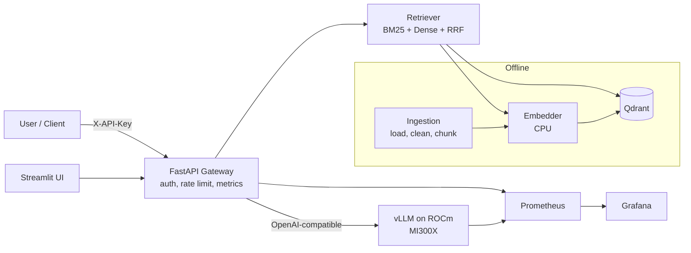

# PrivateDocs-LLM 🔒

> **A self-hosted, air-gapped LLM + RAG platform for confidential enterprise documents, benchmarked on AMD Instinct™ MI300X.**

[](https://github.com/example/privatedocs-llm/actions/workflows/ci.yml)
[](LICENSE)
[](pyproject.toml)

---

## 1. System Overview

Banks, healthcare institutions, law firms, and defense manufacturers face strict data sovereignty and compliance requirements prohibiting third-party API transmissions. **PrivateDocs-LLM** provides an end-to-end, zero-data-egress question-answering architecture that operates identically on local CPU laptops during development and scales to a single 192 GB AMD Instinct MI300X accelerator in production.

### Architecture Diagram



---

## 2. Key Highlights & Design Principles

- **Zero Third-Party Egress**: All parsing, dense vector indexing, BM25 keyword matching, and LLM inference run strictly within the self-hosted environment.
- **Unified OpenAI-Compatible Contract**: Decoupled gateway interfaces seamlessly with local CPU servers (Ollama / llama.cpp / mock) and droplet accelerators (vLLM on ROCm) via standard `/v1/chat/completions`.
- **Hybrid Retrieval with Reciprocal Rank Fusion (RRF)**: Merges dense vector embeddings (`BAAI/bge-small-en-v1.5` on CPU) with sparse lexical search (`rank-bm25`).
- **Grounded Citations & Honest Abstention**: System prompts enforce exact `[doc_id, page]` source citations and instruct the model to state *"I don't know based on the provided documents"* when facts are absent.
- **Enterprise Observability**: Native Prometheus instrumentation (`ask_latency_seconds`, `llm_ttft_seconds`, `tokens_generated`, `rate_limited_total`) paired with pre-configured Grafana dashboards.

---

## 3. Quickstart (Local Development)

### Prerequisites
- Python 3.11+
- Git
- `uv` (recommended) or standard `python3-venv`

```bash
# 1. Clone the repository
git clone https://github.com/example/privatedocs-llm.git
cd privatedocs-llm

# 2. Configure environment variables
cp .env.example .env

# 3. Setup virtual environment and dependencies
uv venv && uv pip install -e ".[app,eval,dev]"
# Or: make setup-local

# 4. Run automated unit tests
pytest -v tests/
# Or: make test

# 5. Run end-to-end local smoke test
python scripts/local/smoke_test.sh
# Or: make smoke-local
```

### Starting the Local Docker Stack
```bash
docker compose -f docker/compose.local.yml up -d
```
- **Streamlit Web UI**: [http://localhost:8501](http://localhost:8501)
- **FastAPI OpenAPI Docs**: [http://localhost:8000/docs](http://localhost:8000/docs)
- **Grafana Platform Dashboard**: [http://localhost:3000](http://localhost:3000) (admin / admin)
- **Prometheus Metrics**: [http://localhost:9090](http://localhost:9090)

---

## 4. API Specification

| Endpoint | Method | Role | Description |
|---|---|---|---|
| `/v1/ask` | `POST` | `user`, `admin` | Ask question with dense/bm25/hybrid retrieval and citations |
| `/v1/ingest` | `POST` | `admin` | Ingest and index PDF, HTML, TXT, or Markdown documents |
| `/v1/documents` | `GET` | `user`, `admin` | List all indexed documents and chunk statistics |
| `/healthz` | `GET` | Public | Liveness health check |
| `/readyz` | `GET` | Public | Readiness check verifying Qdrant and LLM connectivity |
| `/metrics` | `GET` | Scraper | Prometheus metrics endpoint |

Authentication is passed via the `X-API-Key` HTTP header.

---

## 5. Research Matrix & Benchmarks (AMD MI300X)

### Experiment Matrix (`benchmarks/matrix.yaml`)

| ID | Model Class | Precision | Purpose | Concurrency Levels |
|---|---|---|---|---|
| **E0** | Small (~8B) | BF16 | Smoke test and baseline pipeline validation | 1, 8, 32, 64 |
| **E1** | Small (~8B) | FP8 | Precision effect on small model throughput | 1, 8, 32, 64 |
| **E2** | Medium (~30B) | BF16 | Mid-size baseline performance | 1, 8, 32, 64 |
| **E3** | Medium (~30B) | FP8 | Precision effect on mid-size architecture | 1, 8, 32, 64 |
| **E4** | Large (~70B) | BF16 | MI300X single-GPU 70B showcase (140GB weights) | 1, 8, 32, 64 |
| **E5** | Large (~70B) | FP8 | Concurrency headroom and expanded KV cache | 1, 8, 32, 64 |

### Economic Break-Even Formula
$$\text{Cost per 1M Output Tokens} = \left(\frac{\$1.99}{\text{Tokens per Hour}}\right) \times 1{,}000{,}000$$

*(Results from execution on MI300X will populate `results/` and `docs/cost-analysis.md`)*.

---

## 6. Security & Honest Limitations

See [`docs/security.md`](docs/security.md) for the detailed threat model.

### Implemented Controls
- SHA-256 hashed API keys stored in local SQLite database.
- Per-key sliding-window rate limiting with `Retry-After` headers.
- Zero document content or raw query logging at `INFO` level.
- Network isolation via SSH local port forwarding.

### Known Gaps & Out-of-Scope
- No document-level ACLs (all authenticated users query the full collection).
- Unencrypted vector storage at rest (relies on host disk-level LUKS encryption).
- Reference single-node implementation without multi-node distributed clustering.

---

## 7. License

Licensed under the [Apache License, Version 2.0](LICENSE).
