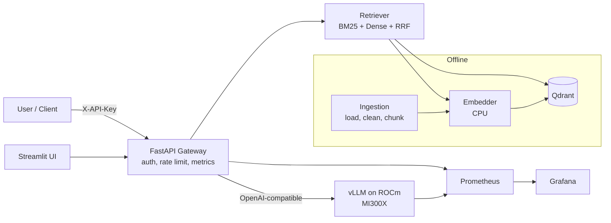

# Architecture: PrivateDocs-LLM

## System Overview

PrivateDocs-LLM is a self-hosted, confidential document question-answering platform designed to operate with zero third-party data egress. It decouples document ingestion, embedding retrieval, and generation while providing uniform interfaces across both local CPU development environments and production AMD Instinct MI300X accelerators.

## Core Components

1. **API Gateway (FastAPI)**:
   - Authenticates requests via hashed SHA-256 API keys stored in SQLite.
   - Enforces per-key token-bucket / sliding-window rate limits.
   - Collects Prometheus latency, TTFT, and token usage metrics.
   - Never logs document contents or raw queries at INFO level to prevent sensitive data leakage.

2. **Ingestion & Indexing**:
   - Parses PDF, HTML, TXT, and Markdown files.
   - Standardizes metadata (`doc_id`, `source`, `page`, `section`).
   - Generates deterministic chunk identifiers using content hashing to guarantee idempotency.
   - Extracts dense embeddings using CPU sentence-transformers (`BAAI/bge-small-en-v1.5`).
   - Updates Qdrant vector store and BM25 inverted index.

3. **Hybrid Retrieval**:
   - Dense vector similarity search via Qdrant.
   - Sparse lexical search via BM25 (`rank-bm25`).
   - Reciprocal Rank Fusion (RRF) to merge ranked lists with configurable `k` (default 60).
   - Optional cross-encoder reranking behind `RERANK_ENABLED`.

4. **Generation & LLM Client**:
   - OpenAI-compatible HTTP client interfacing with Ollama / llama.cpp locally and vLLM ROCm on MI300X.
   - Strict citation enforcement prompt templates (`[doc_id, page]`).
   - Honest abstention fallback ("I don't know based on the provided documents").
   - Streaming, retries with exponential backoff, and robust error handling.

5. **Observability**:
   - Prometheus metrics for gateway and RAG operations.
   - Auto-provisioned Grafana dashboard (`llm-platform.json`).
